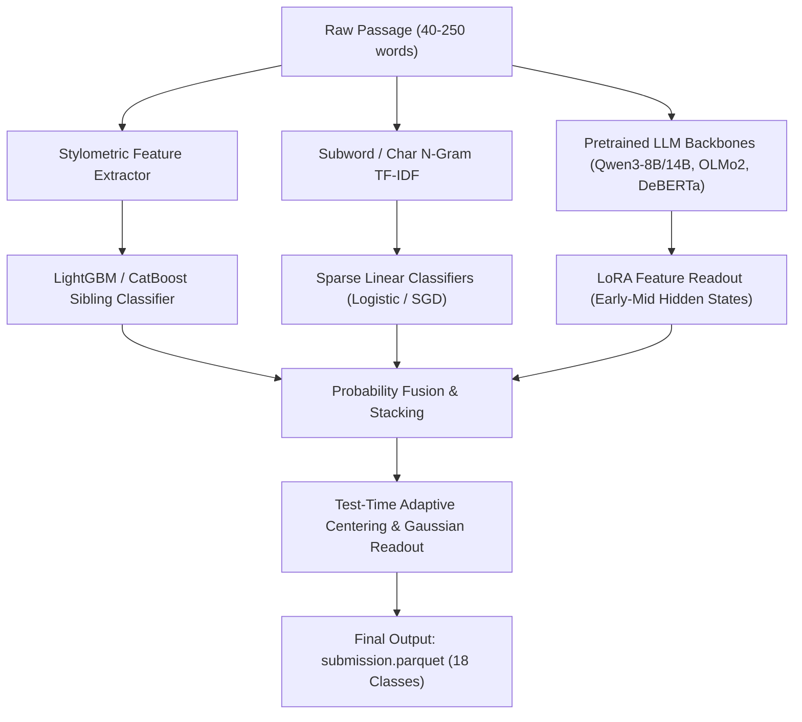

# AGENTS.md — "Name That LLM" Autonomous Competition Master Plan

> **Competition**: [Name That LLM | Kaggle](https://www.kaggle.com/competitions/name-that-llm/overview)  
> **Host / Sponsor**: Kaggle & Google LLC  
> **Prize Pool**: $50,000 USD (Equal split: $5,000 each for 1st through 10th place)  
> **Environment**: Dual Nvidia T4 (2x 16 GB = 32 GB VRAM) / Offline Execution / <= 9 Hours Runtime  
> **Workspace**: `/Users/pika/Documents/Projects/kaggle-llm`

---

## 1. Executive Summary & Problem Formulation

### 1.1 Objective
Given an unlabelled, authentic paragraph completion ranging from **40 to 250 words** written in response to an unseen prompt (spanning philosophy, physics, mathematics, biology, computer science, and creative prose), classify which of **18 frontier language models** across **6 AI laboratories** authored the text.

### 1.2 Evaluation Metric: Balanced Accuracy
Submissions are evaluated on **Balanced Accuracy** across the $K = 18$ candidate models:

$$\text{Balanced Accuracy} = \frac{1}{K} \sum_{k=1}^{K} \frac{|\{i : y_i = k \wedge \hat{y}_i = k\}|}{|\{i : y_i = k\}|}$$

- **Properties**:
  - Balanced accuracy computes the unweighted average of per-class recall across all 18 classes.
  - Baseline random guessing score is $\frac{1}{18} \approx 0.0556$ (5.56%).
  - The hidden test set passage counts per model are **not equal**, and the model mixture differs between the public (20-30%) and private (70-80%) leaderboards.
  - Because each model carries equal weight ($1/18$), any collapse in recall on minority or difficult sibling models severely punishes the global score.

### 1.3 Timeline & Deadlines
- **Start Date**: October 14, 2026
- **Entry & Team Merger Deadline**: January 6, 2027 (11:59 PM UTC)
- **Final Submission Deadline**: January 13, 2027 (11:59 PM UTC)

---

## 2. Target Classes & The 18 Models

Every prediction must match exactly one of the following 18 model strings:

| Lab / Provider | Candidate Model Identifier | Key Stylometric Notes |
| :--- | :--- | :--- |
| **OpenAI** | `gpt-5.5` | High curly quote/apostrophe usage, moderate em-dash rate |
| **OpenAI** | `gpt-5.6-luna` | Distinct vocabulary distribution, ~37% em-dash rate |
| **OpenAI** | `gpt-5.6-sol` | Reasoning variant, specific discourse transition markers |
| **OpenAI** | `gpt-5.6-terra` | Grounded factual phrasing, low variance in sentence length |
| **OpenAI** | `gpt-6-astra` | Low em-dash rate (~9%), subtle rhythm signatures |
| **Google** | `gemini-3.1-pro-preview` | Deep structured responses, curly punctuation |
| **Google** | `gemini-3.6-flash` | Concise phrasing, almost 0% em dashes in competition train |
| **Google** | `gemini-3.7-flash` | Fast factual responses, low punctuation artifacting |
| **Google** | `gemini-3.8-flash` | High fluency, 6-31% curly apostrophe variance across siblings |
| **Anthropic** | `claude-fable-5` | Creative/narrative nuances, heavy straight quotes |
| **Anthropic** | `claude-opus-4-6` | High em-dash usage (63-83%), straight quotes, reflective tone |
| **Anthropic** | `claude-opus-4-8` | Balanced depth, high vocabulary richness |
| **Anthropic** | `claude-opus-5` | Exceptional reasoning flow, strong stylistic consistency |
| **Anthropic** | `claude-sonnet-5` | Precise, clean technical exposition |
| **Qwen** | `qwen3.8-max` | Unique token boundary habits, bilingual residual patterns |
| **ZAI** | `glm-5.3` | Em-dash rate 79-82%, straight quotes, resembles Claude on typography |
| **ZAI** | `glm-5.3-flash` | High speed, slight compression in sentence length vs full 5.3 |
| **Moonshot AI**| `kimi-k3` | Distinct long-context phrasing patterns, structured reasoning |

### The Two-Level Attribution Challenge:
1. **Lab-Level Discrimination (Coarse)**: Separating labs (OpenAI vs Google vs Anthropic vs Qwen vs ZAI vs Moonshot) is relatively tractable (~60% accuracy via TF-IDF + LightGBM) due to typography conventions (e.g., straight quotes vs curly quotes, em-dash frequencies).
2. **Sibling-Level Discrimination (Fine)**: Over **55% to 58% of classification errors** occur where the model correctly predicts the lab, but chooses the wrong sibling model (e.g. `glm-5.3` vs `glm-5.3-flash`, or distinguishing among the 5 Claude or 5 GPT variants). Classical stylometry struggles here; fine-tuned LLM embeddings and representation layers are necessary.

---

## 3. Dataset Architecture & File Specs

### 3.1 Input Files
- `/kaggle/input/competitions/name-that-llm/train.csv` (2,699 rows):
  - `id` *(string)*: Unique anonymized passage ID.
  - `prompt_id` *(string)*: Anonymized identifier of the prompt answered. Exactly **150 unique prompts** exist.
    - 149 prompts have exactly 18 responses (one per candidate model).
    - 1 prompt (`p002`) has 17 responses (`claude-fable-5` is missing).
    - Every passage is a single authentic paragraph completion (only superficial bold/markdown wrapping stripped).
  - `text` *(string)*: The completion text (40 to 250 words).
  - `model` *(string)*: Ground truth model label (one of the 18 valid names).
- `/kaggle/input/competitions/name-that-llm/test.csv`:
  - Contains **3 dummy rows** during interactive development.
  - Contains **~4,000 hidden test rows** during submission rerun.
  - Written for prompts that **do not appear** in `train.csv`.
  - `id` *(string)*, `text` *(string)*.
- `/kaggle/input/competitions/name-that-llm/sample_submission.parquet`:
  - Reference schema: columns `id` and `model`.

### 3.2 Submission Specifications
- Output must be saved as `submission.parquet` in the working directory (`./submission.parquet`).
- Minimal submission code:
  ```python
  import pandas as pd
  test = pd.read_csv('/kaggle/input/competitions/name-that-llm/test.csv')
  sub = pd.DataFrame({'id': test['id'], 'model': predictions})
  sub.to_parquet('submission.parquet', index=False)
  ```
- Submissions will be rejected if:
  - Missing `id` or `model` column.
  - Contains null/NaN values.
  - Missing any test `id` or containing duplicate `id`s.
  - Any predicted label outside the 18 exact allowed names.
  - File is not named `submission.parquet` or not in Parquet format.

---

## 4. Empirical Benchmark Findings & Critical Traps

### 4.1 Cross-Validation: Grouped vs Random Splits
- **Mandatory**: Use `StratifiedGroupKFold(n_splits=5, shuffle=True, random_state=42)` grouped strictly on `prompt_id`.
- **The Pitfall**: Standard `StratifiedKFold` leaks prompt content across folds. When a validation passage answers prompt $P$, training passages with prompt $P$ belong to the other 17 models. Topic-specific vocabulary acts as a distractor, pulling predictions toward incorrect labels and resulting in a misleadingly pessimistic CV score (~0.217 vs ~0.369).
- **Grouped CV tracks Public Leaderboard (LB) accurately**:
  - Baseline TF-IDF + Logistic Regression: Grouped CV `0.343` $\rightarrow$ Public LB `0.353`.

### 4.2 Text Preprocessing: DO NOT Sanitize Text
- **Never lowercase the text**: Punctuation casing, capitalization patterns (e.g. German capitalization remnants, capitalized acronyms, title casing) are model signatures.
- **Never normalize quotation marks or dashes**:
  - Claude and GLM almost exclusively emit straight quotes (`"` and `'`).
  - OpenAI and Gemini predominantly emit typographic curly quotes/apostrophes (`“`, `”`, `’`).
  - Em dashes (`—`) appear in 79-82% of GLM passages and 63-83% of Claude passages, but virtually 0% of competition Gemini completions.
  - *Caution*: Do not enforce hard rule-based filters. External proxy data shows reasoning variants can alter em-dash rates. Use these patterns as feature signals and probabilistic priors.

### 4.3 Passage Length Hardness
- Passages span ~40 to 250 words.
- Passages under 60 words suffer significantly lower accuracy (~0.27) compared to passages over 160 words (~0.46).
- **Mitigation Strategy**: Implement length-stratified evaluation and apply random truncation augmentation during LLM fine-tuning to force the network to recognize short-context fingerprints.

### 4.4 Prompt Clustering & Post-Processing Realities
- **The Hungarian Assignment Trap**: In `train.csv`, each prompt is answered exactly once by each model. Solving linear sum assignment (`scipy.optimize.linear_sum_assignment`) on clustered test prompts inflated CV by +0.10, but **degraded Public LB from 0.353 to 0.344**.
- **Root Cause**: The test set is subsampled and does not contain balanced 18-model rounds per prompt. Hard mutual exclusion forces erroneous reassignments.
- **Winning Alternative**: Soft post-processing, such as adaptive centering, cluster mean probability subtraction, and Gaussian ensemble readouts (scores up to **0.595 LB** in public work).

### 4.5 LLM Layer Representation Nuance
- Early-to-middle transformer layers in foundation models (e.g. Qwen, OLMo2) retain significantly higher stylometric and tokenization-distribution fidelity (~0.39) compared to final semantic prediction layers (~0.31), which over-abstract to task meaning rather than author persona.

---

## 5. Kaggle T4x2 Hardware & Runtime Constraints

| Resource | Specification | Optimization Rules |
| :--- | :--- | :--- |
| **GPU Acceleration** | 2x Nvidia T4 (16 GB GDDR6 each = 32 GB total) | **No bfloat16 support**. Must use `torch.float16`. |
| **Model Size Limit** | 7B to 14B parameters | A 14B model (~27.6 GiB in fp16) spans both T4s via `device_map="auto"` with `max_memory={0: "14GiB", 1: "14GiB"}`. |
| **Network Access** | **Disabled** during scoring rerun | All model weights, tokenizers, libraries, and external datasets must be pre-uploaded as Kaggle Datasets. |
| **Notebook Runtime** | Max 9.0 hours | Pre-merge LoRA adapters into base weights to eliminate PEFT overhead. |
| **Inference Throughput**| ~4,000 passages in rerun | Sort test passages by token length before batching (batch size 8-16) to minimize padding tokens. Expected test inference: 15-20 min for a 14B model. |

### 5.1 Hardware Strategy: Dual T4 (2xT4) vs. TPU v5e-8

| Dimension | Dual Nvidia T4 (2x 16 GB = 32 GB VRAM) | Kaggle TPU v5e-8 (128 GB HBM, 8 chips) |
| :--- | :--- | :--- |
| **Verdict** | **Primary Target for End-to-End Pipeline & Submissions** | **Optional High-Throughput Pretrainer Only** |
| **Library Support** | Native Hugging Face `transformers`, `peft`, `bitsandbytes`, `accelerate`, `vllm`. Zero friction. | Requires `torch_xla`. High boilerplate, recompilation overhead, fragile dependency stacks. |
| **Precision** | `torch.float16` (no native `bfloat16` on Turing architecture). | Native `bfloat16` with massive matrix multiplication throughput. |
| **Inference Stability** | Highly deterministic, handles dynamic sequence padding smoothly (~15-20m for 4k passages). | Static padding mandatory; dynamic lengths trigger repeated graph recompilations and timeouts in hidden rerun. |
| **Quota Allocation** | 30 hours / week GPU quota. | 20 hours / week TPU quota. |
| **SOTA Validation** | All public SOTA notebooks (0.574 - 0.595 LB) run natively on Dual T4. | Rare on the leaderboard due to PEFT/LoRA integration headaches. |

> **Conclusion**: Dual T4 (2xT4) can do **everything** required for this competition. Use TPU v5e-8 strictly if full-precision pretraining on 100k+ external examples is needed outside the submission path.

### 5.2 Audit of Starter Notebook (`starter-notebook-for-name-that-llm-competition.ipynb`)

The official starter notebook scores **0.3145 CV** (vs. **0.3426 CV / 0.353 LB** in the optimized baseline). Four major flaws in the starter code:
1. **Lowercasing Destruction**: The starter uses default `TfidfVectorizer()`, which forces `lowercase=True`. This erases critical model capitalization fingerprints (e.g. title-cased words, acronyms, German capitalization habits).
2. **Narrow N-Gram Range & Vocabulary Capping**: Starter caps word n-grams at `max_features=25000` (range 1-2) and character n-grams at `max_features=35000` (range 3-5). Increasing to 200k words and 300k chars (range 1-5) captures authorial subword tokens and morphological roots.
3. **Punctuation Stripping**: The starter vectorizer uses default scikit-learn regex `(?u)\b\w\w+\b`, silently discarding all single-character tokens and punctuation. Punctuation patterns (em dashes, straight/curly quotes) contain >60% of lab-separation signal!
4. **Sub-optimal Fold Splitting**: Uses standard `GroupKFold` instead of `StratifiedGroupKFold(shuffle=True, random_state=42)`. Without stratification, class distributions across folds fluctuate.

---

## 6. End-to-End Solution Architecture



### Phase 1: Fast Baseline & Verified Grouped CV Pipeline
1. Build deterministic 5-fold `StratifiedGroupKFold` on `prompt_id`.
2. Construct dual TF-IDF pipeline:
   - Word n-grams: `(1, 2)`, max features 200k, token pattern preserving punctuation.
   - Character n-grams: `(1, 5)`, max features 300k, `lowercase=False`.
3. Train Logistic Regression / SGDClassifier with balanced class weighting. Target CV: `~0.345`, LB: `~0.353`.

### Phase 2: Stylometric Feature Engineering Engine
Extract 100+ typography, lexical diversity, and syntactic features:
- Punctuation frequencies: em dash (`—`), en dash (`–`), hyphen (`-`), straight vs curly quotes (`'`, `"`, `‘`, `’`, `“`, `”`), semicolons, colons, ellipses.
- Lexical metrics: Type-Token Ratio (TTR), Simpson's Index, Yule's K, Hapax Legomena ratio.
- Structural statistics: Mean and standard deviation of sentence lengths, word lengths, capitalization rates, numeral ratios.
- Train LightGBM / CatBoost models on these features to establish a pure stylometry baseline.

### Phase 3: Foundation Model Fine-Tuning (LoRA & Two-Stage)
1. **Model Selection**:
   - `Qwen/Qwen2.5-7B` / `Qwen2.5-14B`
   - `Qwen3-8B` / `Qwen3-14B`
   - `allenai/OLMo-2-1124-7B`
   - `microsoft/deberta-v3-large`
2. **LoRA Configuration**:
   - Target modules: all linear projection layers (`q_proj`, `k_proj`, `v_proj`, `o_proj`, `gate_proj`, `up_proj`, `down_proj`).
   - Rank $r=16$, $\alpha=32$, dropout $0.05$.
   - Max sequence length: 384 tokens (fully covers the 250-word maximum).
3. **Training Protocol**:
   - Sequence truncation augmentation (randomly cropping to 40-80 words on 20% of samples).
   - Multi-sample dropout with cross-entropy loss adjusted for balanced accuracy.
   - Stage 1: Fine-tune on external multi-model corpus.
   - Stage 2: Fine-tune / calibrate on official competition `train.csv`.

### Phase 4: External Data Integration
- Integrate verified external corpora (e.g. Oleg Zholobov's 18-model response corpus with 1,902 prompt groups answered across all 18 models).
- Filter strictly for single-paragraph candidates between 40 and 250 words.
- Verify prompt leak prevention by checking similarity against test set candidate domains.

### Phase 5: Calibration & Adaptive Ensembling
- Extract out-of-fold log-odds / logits from all models.
- Apply temperature scaling and Dirichlet calibration per class to balance per-class recall.
- Use soft adaptive centering: compute semantic embeddings of test passages, identify prompt neighborhoods, and center logits by subtracting cluster means.

### Phase 6: Production Offline Submission Packaging
- Package tokenizer, model configurations, and merged fp16 weights into a standalone Kaggle dataset.
- Script a clean, self-contained inference script generating `submission.parquet`.
- Verify runtime under 30 minutes on 2x T4 without internet access.

---

## 7. Autonomous Execution Directives (YOLO Mode)

When executing tasks via background OpenCode / GLM terminals:

1. **Local vs Remote Execution Invariant (Strict Rule)**:
   - **NO local model training or heavy inference**: The local environment is strictly for code authoring, linting, packaging, unit testing of pipeline abstractions, and Kaggle API submission dispatch.
   - **All training and model inference runs on Kaggle**: Kaggle Dual T4 (or TPU v5e-8 when explicitly assigned) is the sole compute engine for model execution.
2. **Working Directory & Artifacts**:
   - All code, scripts, and experiments must reside under `/Users/pika/Documents/Projects/kaggle-llm/`.
   - Use structured subdirectories:
     - `src/`: Core Python modules (dataset loaders, metrics, models, features).
     - `experiments/`: Experiment training scripts and logs.
     - `notebooks/`: Kaggle submission-ready self-contained scripts/notebooks.
     - `data/`: Local cache for schemas, dummy rows, and external metadata.
     - `weights/`: Merged checkpoint weights (tracked or uploaded to Kaggle Datasets).
3. **Verification Gate Before Any Claim**:
   - Compute and log the exact `balanced_accuracy_score(y_true, y_pred)` across the 5 grouped folds.
   - Never report overall accuracy without reporting per-class recalls and confusion matrix among sibling models.
4. **Reproducibility Invariant**:
   - Fix all random seeds (`seed=42`).
   - Log hardware utilization, GPU memory footprint, and wall-clock times.
5. **Parquet & Submission Integrity Check**:
   - Always run an automated validation test on generated `submission.parquet`:
     ```python
     assert sub.shape == (len(test), 2)
     assert list(sub.columns) == ['id', 'model']
     assert sub['model'].isin(VALID_18_MODELS).all()
     assert not sub.isnull().any().any()
     ```
