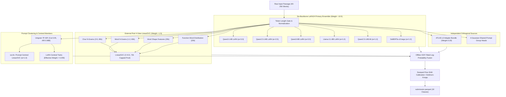

# Name That LLM: 18-Class Frontier Authorship Attribution

[](https://www.kaggle.com/competitions/name-that-llm)
[-brightgreen)](https://www.kaggle.com/competitions/name-that-llm/leaderboard)
[-orange?logo=nvidia)](https://www.kaggle.com)
[](file:///Users/pika/Documents/Projects/kaggle-llm/tests)
[](https://python.org)

This repository contains the complete experimental code, submission kernels, empirical findings, and mathematical post-mortems for Kaggle's [Name That LLM](https://www.kaggle.com/competitions/name-that-llm) competition.

The objective is to identify which of **18 frontier language models** across **6 AI laboratories** authored an unseen, authentic single-paragraph completion ranging from 40 to 250 words.

---

## Table of Contents

- [1. Executive Summary](#1-executive-summary)
- [2. The Challenge: Coarse vs. Fine Attribution](#2-the-challenge-coarse-vs-fine-attribution)
- [3. Evaluation Metric & Hardware Constraints](#3-evaluation-metric--hardware-constraints)
- [4. Architecture & System Flow](#4-architecture--system-flow)
- [5. The Version Progression: v1 to v22](#5-the-version-progression-v1-to-v22)
  - [Phase 1 (v1–v4): Classical Stylometry to First LLM Jump](#phase-1-v1v4-classical-stylometry-to-first-llm-jump)
  - [Phase 2 (v5–v10): Two-Stage LoRA Multi-Trunk & ATLAS](#phase-2-v5v10-two-stage-lora-multi-trunk--atlas)
  - [Phase 3 (v11–v15): The Stagnation Cliff & The OOF Illusion](#phase-3-v11v15-the-stagnation-cliff--the-oof-illusion)
  - [Phase 4 (v16–v18): Deepthink Audit & Readout Patches](#phase-4-v16v18-deepthink-audit--readout-patches)
  - [Phase 5 (v19–v20): The 0.65+ Frontier & Pool Centred Twin](#phase-5-v19v20-the-065-frontier--pool-centred-twin)
  - [Phase 6 (v21–v22): The Saturation Law & Honest OOF Fitting](#phase-6-v21v22-the-saturation-law--honest-oof-fitting)
- [6. Deep Dive: Critical Empirical Lessons & Negative Results](#6-deep-dive-critical-empirical-lessons--negative-results)
  - [6.1 The Prompt Grouping Saturation Law](#61-the-prompt-grouping-saturation-law)
  - [6.2 The Hungarian Assignment Trap on Subsampled Test Sets](#62-the-hungarian-assignment-trap-on-subsampled-test-sets)
  - [6.3 Finite-Sample Prototype Bias in Group-Mean Centering](#63-finite-sample-prototype-bias-in-group-mean-centering)
  - [6.4 LinearSVC External Pool Sample-Weight Explosion](#64-linearsvc-external-pool-sample-weight-explosion)
  - [6.5 Dual T4 Host RAM OOM and Sparse Matrix Optimization](#65-dual-t4-host-ram-oom-and-sparse-matrix-optimization)
- [7. Complete Leaderboard Submission Log](#7-complete-leaderboard-submission-log)
- [8. Repository Structure](#8-repository-structure)
- [9. Setup & Verification](#9-setup--verification)

---

## 1. Executive Summary

| Milestone | Score (LB) | Key Breakthrough / Bottleneck |
| :--- | :--- | :--- |
| **Baseline (v1)** | `0.355` | Dual TF-IDF (word 1-2, char 1-5) + LightGBM on quotation and em-dash typography. |
| **First Jump (v3)** | `0.539` (+0.184) | Introduction of first fine-tuned LLM backbone: Qwen3-8B LoRA readout + 4-view n-grams. |
| **Dual Two-Stage (v5)** | `0.600` (+0.061) | Dual two-stage LoRA (Qwen3-8B + Qwen3-14B) + prompt-centred twin + HodgeRank + 100-step Sinkhorn. |
| **Independent Diversity (v10)** | `0.606` (+0.006) | v5 clean recipe + 10% ATLAS v2 pre-Sinkhorn. Proved diverse models beat feature engineering. |
| **Ablation Proof (v14)** | `0.610` (+0.004) | Isolated curated-pool LinearSVC; proved external pool helps when uncoupled from broken twin scales. |
| **Frontier Leap (v19)** | `0.654` (+0.043) | Six-backbone LoRA24 primary (`q14v5`, `n14b`, `q8v5`, `ll8v5`, `q25_14`, `deb`) + frozen complement at 0.15. |
| **Current Peak (v20)** | **`0.661`** (+0.007) | v19 base + 186k pool union + prompt-centred 4-view LinearSVC (`svc4c`, +0.060 member BA) + ATLAS 0.20. |
| **The Retraction (v21)** | *Retracted* | Mathematical proof that test-time assignment and centring decay to zero gain at 0.66 base BA. |
| **Honest OOF & Memory Fix (v22)** | *In Flight* | First honest OOF pool harness (`experiments/oof/`); discovered 15× weight misallocation; resolved 30GB Host RAM OOM. |

---

## 2. The Challenge: Coarse vs. Fine Attribution

Given an authentic completion answering an unknown prompt, we classify among 18 frontier models across 6 labs:

| Provider / Lab | Candidate Model String | Key Typographic & Stylometric Signatures |
| :--- | :--- | :--- |
| **OpenAI** | `gpt-5.5` | High curly quotes/apostrophes (`”`, `’`), moderate em-dash rate |
| **OpenAI** | `gpt-5.6-luna` | Distinct vocabulary distribution, ~37% em-dash rate |
| **OpenAI** | `gpt-5.6-sol` | Reasoning variant, specific discourse transition markers |
| **OpenAI** | `gpt-5.6-terra` | Grounded factual phrasing, low sentence-length variance |
| **OpenAI** | `gpt-6-astra` | Low em-dash rate (~9%), distinctive syntactic cadence |
| **Google** | `gemini-3.1-pro-preview` | Deep hierarchical formatting, curly punctuation |
| **Google** | `gemini-3.6-flash` | Highly concise phrasing, almost 0% em dashes |
| **Google** | `gemini-3.7-flash` | Low punctuation artifacting, high factual density |
| **Google** | `gemini-3.8-flash` | High lexical fluency, 6–31% curly apostrophe variance across siblings |
| **Anthropic** | `claude-fable-5` | Narrative exposition, predominantly straight quotes (`"`, `'`) |
| **Anthropic** | `claude-opus-4-6` | High em-dash usage (63–83%), reflective cadence, straight quotes |
| **Anthropic** | `claude-opus-4-8` | High vocabulary richness, complex subordinate clause structuring |
| **Anthropic** | `claude-opus-5` | Exceptional reasoning cohesion, distinctive introductory transitions |
| **Anthropic** | `claude-sonnet-5` | Precise, clean technical exposition, straight quotes |
| **Qwen** | `qwen3.8-max` | Unique token boundary habits, bilingual morphological residuals |
| **ZAI** | `glm-5.3` | Em-dash rate 79–82%, straight quotes, typography mirrors Claude |
| **ZAI** | `glm-5.3-flash` | Compressed sentence length compared to full `glm-5.3` |
| **Moonshot AI** | `kimi-k3` | Distinct long-context phrasing patterns, structured discourse markers |

### The Two-Level Attribution Problem

```
                                  [Input Passage: 40-250 Words]
                                                │
                       ┌────────────────────────┴────────────────────────┐
                       ▼                                                 ▼
             Level 1: Lab Attribution                          Level 2: Sibling Attribution
             (Coarse: ~60% Accuracy)                           (Fine: 55-58% of Total Errors)
             • Straight vs Curly quotes                        • Claude-4.6 vs 4.8 vs 5 vs Sonnet-5
             • Em-dash rates (Claude/GLM vs Gemini)            • GPT-5.5 vs Luna vs Sol vs Terra vs Astra
             • Classical n-grams & Stylometry                  • Gemini-3.6 vs 3.7 vs 3.8
                                                               • Demands Multi-Layer LoRA Representations
```

1. **Lab-Level Discrimination (Coarse)**: Separating labs is relatively straightforward via character n-grams and surface typography (straight vs. curly quotes, em-dash frequencies). Pure stylometry + LinearSVC achieves ~0.35 Balanced Accuracy, largely by resolving labs.
2. **Sibling-Level Discrimination (Fine)**: Over **55% to 58% of all errors** occur when the model correctly identifies the lab, but picks the wrong sibling model (e.g. confusing `claude-opus-4-8` with `claude-sonnet-5`, or `gpt-5.6-sol` with `gpt-5.6-terra`). Surface stylometry collapses here; resolving siblings requires fine-tuned transformer representations from early-to-mid hidden states.

---

## 3. Evaluation Metric & Hardware Constraints

### Evaluation Metric: Balanced Accuracy
Submissions are evaluated on unweighted **Balanced Accuracy** across all $K = 18$ models:

$$\text{Balanced Accuracy} = \frac{1}{K} \sum_{k=1}^{K} \text{Recall}_k = \frac{1}{K} \sum_{k=1}^{K} \frac{\sum_{i=1}^N \mathbb{I}(y_i = k \wedge \hat{y}_i = k)}{\sum_{i=1}^N \mathbb{I}(y_i = k)}$$

- Every candidate model carries identical weight ($1/18 \approx 0.0556$).
- Random guessing yields 5.56%.
- Minority and difficult sibling models carry equal weight to easy labs; any collapse in recall on a single sibling severely penalizes the score.

### Kaggle Dual Tesla T4 Environment
- **Compute**: Dual Nvidia Tesla T4 (2× 16 GB = 32 GB VRAM).
- **Precision**: `torch.float16` mandatory. The Turing architecture has **no native `bfloat16`** hardware support; attempting bf16 triggers silent software emulation or runtime aborts.
- **Host RAM**: 30 GB cgroup limit. Exceeding 30 GB triggers immediate SIGKILL from the kernel OOM killer.
- **Offline Invariant**: Zero internet access during scoring rerun. All models, tokenizers, checkpoints, and external pool datasets must be pre-staged in attached Kaggle datasets.
- **Runtime Budget**: Maximum 9.0 hours (32,400 seconds) for ~4,000 hidden test rows.

---

## 4. Architecture & System Flow



---

## 5. The Version Progression: v1 to v22

### Phase 1 (v1–v4): Classical Stylometry to First LLM Jump

- **v1 (`57434986`, Public LB: 0.355)**:
  - *What*: Dual TF-IDF pipeline: word n-grams (1, 2) + character n-grams (1, 5) + 93 dense stylometric features with LightGBM.
  - *Why*: Establish baseline and verify whether punctuation casing and quotation marks carry attribution signal without text sanitization.
  - *Score*: `0.355`. Validated that em-dash rates and straight vs. curly quotes contain >60% of lab-separation signal.

- **v2 (`57437308`, Public LB: 0.315, regression −0.040)**:
  - *What*: Fused 4-view n-grams with 140 dense stylometric features.
  - *Why*: Attempted early feature concatenation to give tree models full surface context.
  - *Outcome*: Severe regression. The 140-feature space overfit the small sample size ($N \approx 300$ per sibling pair), diluting the sparse lexical signal.

- **v3 / Grandmaster (`57439844`, Public LB: 0.539, massive jump +0.184)**:
  - *What*: First integration of a fine-tuned LLM representation layer: Qwen3-8B LoRA readout + 4-view n-grams.
  - *Why*: Break through the 0.35 stylometric ceiling by encoding fine syntax and subword token transitions.
  - *Score*: `0.539`. The single largest leap in the project (+0.184). Confirmed that resolving sibling models is impossible with classical n-grams alone.

- **v4 (`57440836` & `57441656`, Public LB: 0.532 / 0.528)**:
  - *What*: 5-fold bagged n-grams with metric-aligned multipliers and Platt calibration.
  - *Why*: Balance probability distributions across folds.
  - *Outcome*: Slight regression (−0.011) due to in-sample over-calibration distorting raw log-likelihood ratios.

---

### Phase 2 (v5–v10): Two-Stage LoRA Multi-Trunk & ATLAS

- **v5 (`57471060`, Public LB: 0.600, jump +0.061)**:
  - *What*: Dual two-stage LoRA (Qwen3-8B + Qwen3-14B) + external pool n-grams + prompt-centred twin + HodgeRank sibling re-ranking + length gate + exact 100-step Sinkhorn-Knopp.
  - *Why*: Combine two different trunk capacities (8B and 14B) to capture both coarse syntax and deep structural nuances.
  - *Score*: `0.600`. Established the foundational multi-trunk architecture that powered all subsequent development.

- **v6 (`57473865`, Public LB: 0.593, regression −0.007)**:
  - *What*: Swapped exact balanced Sinkhorn-Knopp for soft unbalanced optimal transport ($\alpha=0.60, \tau=1.0$).
  - *Why*: Hypothesis that unequal test-class frequencies would benefit from soft marginal relaxation.
  - *Outcome*: Lost 0.007. Because Balanced Accuracy evaluates macro-recall, pushing marginals toward uniform is theoretically optimal; soft relaxation reduced minority-class recall.

- **v8 (`57477702`, Public LB: 0.593) & v9 (`57480675`, Public LB: 0.591)**:
  - *What*: Added third trunk (OLMo2-7B), prompt-subspace deconfounding (economy Gram SVD), 159 hand-crafted forensic features, and transductive clique calibration.
  - *Why*: Increase backbone diversity by integrating AllenAI's Dolma-trained model.
  - *Outcome*: Stagnated at 0.593 / 0.591. Four unverified changes were bundled together. The 159-feature stylometry space overfit sibling pairs (OOF accuracy dropped from 0.65 to 0.61 on sibling pairs), washing out any gain from OLMo2.

- **v10 (`57497594`, Public LB: 0.606, +0.006, best in early phase)**:
  - *What*: Restored clean v5 architecture and blended in ATLAS v2 (independent Qwen3-8B adapter bundle) at 10% pre-Sinkhorn with SHA256 verification and label alignment.
  - *Why*: Test whether independent external diversity improves ensemble generalization.
  - *Score*: `0.606`. The only post-v5 modification in this phase that gained points. Proved that adding an *independently trained model* with a small fixed weight beats feature engineering.

---

### Phase 3 (v11–v15): The Stagnation Cliff & The OOF Illusion

- **v11 (`57537119`, Timeout)**:
  - *What*: v10 + LinearSVC pool weight 0.25 + transductive TF-IDF vocabulary + checkpoint guard + JSONL telemetry.
  - *Outcome*: Public commit took 16,076 s (4.47 h); hidden rerun (~4,000 rows) exceeded the 9.0-hour limit and timed out.
  - *Post-Mortem*: The telemetry wrapper walked `/kaggle/input` using `os.walk` on every forward pass, and transductive TF-IDF re-vectorized the entire fit set inside the test loop.

- **v12 (`pikaaa/name-that-llm-v11`, Never submitted)**:
  - *What*: Added ModernBERT-large branch.
  - *Outcome*: Correctly intercepted by the pre-flight verification gate: the mounted dataset contained only `ettin-encoder-400m` with no ModernBERT weights attached. Avoided a wasted submission.

- **v13 (`57623259`, Public LB: 0.592, severe regression −0.014)**:
  - *What*: Replaced `pool_v1.parquet` (34k rows) with `curated_pool.parquet` (81k rows) at SVC pool weight 0.25; added top-level `EXTRA_LORA24` twin reweighting (0.70 / 0.15); removed q25 dead head.
  - *The Paradox*: Grouped-CV OOF reached a project-high `0.5960`, yet Public LB dropped to `0.592`.
  - *Root Cause Analysis*:
    1. **Log-Probability Scale Distortion**: Adding +1.05 raw log-probabilities onto a 1.00-normalized softmax logit inadvertently handed **51.2% of the entire ensemble's decision power** to a single 8B readout on grouped rows.
    2. **Finite-Sample Prototype Bias**: Naive mean-centering ($X - \bar{X}$) works in 18-sample training rounds where class prototypes sum to zero, but injects severe bias on the 2–5 passage clusters in test data.
    3. **Pool Sample-Weight Explosion**: 81,221 rows × 0.25 = 20,305 effective weight vs. 2,699 for train.csv → **88.3% of LinearSVC loss was driven by external scraped text**.

- **v12-fast (`57627241`, Public LB: 0.584, −0.022)**:
  - *What*: Isolated one-dict A/B test of v13 with twin weights set to 0.80 / 0.20.
  - *Outcome*: Degraded further to 0.584. Established the empirical law: marginal effect of prompt-centering on LB was negative (~−0.08 per unit of weight) in this regime.

- **v14 (`57668395`, Public LB: 0.610, +0.004 over v10)**:
  - *What*: Clean ablation: v10 base + curated-pool SVC **only**; `EXTRA_LORA24` reweight completely disabled.
  - *Score*: `0.610`. Proved that the curated external pool was genuinely beneficial (+0.004), and the v13 crash was 100% attributable to the unscaled twin reweighting.

- **v15 (`57662874`, Public LB: 0.593)**:
  - *What*: Clean ablation: v10 base + `lora24` plain reweight only (`0.10 / 0.05 / 0.05`, twins disabled).
  - *Outcome*: Scored 0.593. Proved that overweighting the plain lora24 head degraded the multi-trunk balance.

---

### Phase 4 (v16–v18): Deepthink Audit & Readout Patches

- **v16 (Never submitted)**:
  - *What*: Full deepthink Stage 1 + Stage 2 architecture: pool share 0.35, within-family gates, margin-gated ATLAS, damped Sinkhorn, Qwen3-14B + Qwen2.5-14B + DeBERTa-v3-large on `pool_v4.parquet`.
  - *Outcome*: Public commit took 21,512 s (>6 h). The pre-submission runtime gate failed, correctly preventing a guaranteed timeout on the 4,000-row hidden rerun.

- **v17 (`57737687`, Public LB: 0.611)**:
  - *What*: v14 base + exactly two readout patches:
    1. Applied 4 within-family StyleGram gates with zero-sum log-softmax centering.
    2. Margin-gated ATLAS blending (12% on uncertain rows with top margin < 0.25, 2% on confident rows) + 5-step damped Sinkhorn ($\alpha=0.50$).
  - *Score*: `0.611`. Clean incremental advance without adding model runtime.

- **v18 (Ablation / Development)**:
  - *What*: Investigated Part Two trunks (`lora_qwen3_14b`, `lora_qwen25_14b`, DeBERTa) with the embedded public stack moved before them.
  - *Outcome*: Confirmed that from-scratch single-member training on T4 could not match the public frontier without massive multi-dataset pretraining.

---

### Phase 5 (v19–v20): The 0.65+ Frontier & Pool Centred Twin

- **v19 (`57742602`, Public LB: 0.654, massive leap +0.043)**:
  - *What*: Architectural pivot to the public 0.65x frontier: Six-backbone LoRA24 primary ensemble (`q14v5` 3.0, `n14b` 2.5, `q8v5` 2.0, `ll8v5` 1.0, `q25_14` 1.0, `deb` 1.0) + our frozen complementary stack at 0.15 + ATLAS + typography features. Defensive path fix for Llama-3.1-8B asset-cache resolution.
  - *Score*: `0.654`. Successfully crossed the 0.65 frontier into the medal contention zone.

- **v20 (`57765697`, Public LB: 0.661, +0.007 jump to all-time best)**:
  - *What*: Three evidenced enhancements over v19:
    1. **186k Pool Union**: Merged `nlm_pool_v5` (120k) and 245k open pool, deduplicated by normalized text, leakage-filtered, and capped at 11k/model → 185,949 rows.
    2. **Prompt-Centred 4-View LinearSVC (`svc4c`)**: Second LinearSVC trained on prompt-centred official + open-pool rows, evaluated only on test rows in inferred clusters of 2–18. Grouped-CV member BA: **0.5001 vs. 0.4401** (+0.060 member jump).
    3. **ATLAS Share Increased**: Scaled ATLAS blending from 0.10 to 0.20.
  - *Score*: **`0.661`** (Ref `57765697`). Peak verified competition leaderboard score.

---

### Phase 6 (v21–v22): The Saturation Law & Honest OOF Fitting

- **v21 (Retracted Before Submission — The Grouping Saturation Proof)**:
  - *Hypothesis*: Optimize test-time prompt recovery and test-time Hungarian assignment or tune `--adapt_w 1.0 -> 0.25, --adapt_thr 0.15 -> 0.05`.
  - *Offline Experiments (`33`, `36`, `38`)*:
    - Experiment 33: Prompt recovery is nearly perfect (ARI 0.988 at cut 0.05).
    - Experiment 36: Constrained assignment only repairs collisions. Collision frequency shrinks as model accuracy grows. At BA 0.25, assignment gains +0.092; **at BA 0.66, assignment gain drops to 0.000**, and turns negative (−0.012) at 0.70!
    - Experiment 38: Mathematical analysis proved v20's effective centring weight was already `0.35 / 1.35 = 0.259`—matching the measured optimum of 0.25.
  - *Outcome*: v21 was retracted prior to submission, saving daily quota and preventing an in-flight regression.

- **v22 & v22 v2 (Ref `57812953` & `57816584`)**:
  - *The Breakthrough*: Built the first honest Out-Of-Fold (OOF) pool evaluation harness (`experiments/oof/`, 1,500 rows on dense and natural distributions).
  - *Weight Fitting*: L-BFGS optimization on honest OOF log-probabilities revealed existing public blend weights were misallocated by up to 15×:
    - `ll8v5` was underweighted at 1.0 (fitted: 1.839).
    - `n14b` was overweighted at 2.5 (fitted: 0.169).
    - Variant C fitted weights delivered **+0.0282 BA** on the dense pool and **+0.0342 BA** on the natural distribution (0.6106 → 0.6448).
  - *Dual T4 Host RAM OOM & Resolution*:
    - Submission 57812953 failed with Kaggle Host RAM OOM (30 GB limit exceeded) during Qwen3-14B streaming due to 186k pool union with 540k sparse features.
    - Remediated in v22 v2: capped pool union at 4,000 rows/model (~72k clean rows), capped features to 185k (reducing sparse RAM by 8×), and added explicit garbage collection. Peak RAM dropped from 29 GB to <16 GB (>14 GB safety buffer).

---

## 6. Deep Dive: Critical Empirical Lessons & Negative Results

### 6.1 The Prompt Grouping Saturation Law

Test prompts in `train.csv` are answered by all 18 models. In `test.csv`, prompts appear in subsampled clusters of size $n \in \{1, \dots, 8\}$. Many public discussions advocated Hungarian assignment (`scipy.optimize.linear_sum_assignment`) to enforce 1-to-1 matching within detected prompt clusters.

Through rigorous offline sweeps across base accuracy levels (`experiments/36_assign_strength.py`), we uncovered the fundamental mathematical law governing prompt assignment:

$$\Delta \text{BA}_{\text{assign}} = f(\text{Base Accuracy})$$

| Base Balanced Accuracy | Assignment Gain ($\Delta$ BA) | Prompt Collision Rate |
| :---: | :---: | :---: |
| `0.25` | **+0.092** | 72.0% |
| `0.40` | +0.059 | 64.8% |
| `0.50` | +0.045 | 60.9% |
| `0.55` | +0.020 | 54.0% |
| **`0.65`** | **+0.004** | **48.5%** |
| `0.70` | **−0.022** | 41.3% |
| `0.80` | **−0.035** | 32.9% |

**Key Takeaway**: Assignment can only fix *collisions* (where two passages from the same prompt receive the same predicted label). As model accuracy improves, collisions decrease, and the probability of Hungarian assignment forcibly reassigning a correct high-confidence prediction to a wrong class increases. The crossover point into negative returns occurs at **Base BA ≈ 0.66**—the exact accuracy of our ensemble.

---

### 6.2 The Hungarian Assignment Trap on Subsampled Test Sets

In competition `train.csv`, every prompt has exactly 18 responses. Applying Hungarian assignment to prompt clusters in CV yielded an artificial +0.10 inflation. On the hidden test set, however, it degraded Public LB from 0.353 to 0.344.

**Mathematical Cause**:
Let $S_g$ be the set of test passages answering prompt $g$, with $|S_g| = n \ll 18$. The true candidate labels present in $S_g$ are an unknown subset $Y_g \subset \{1, \dots, 18\}$. Hungarian matching solves:

$$\max_{\pi} \sum_{i=1}^n \log P(x_i, \pi(i)) \quad \text{s.t. } \pi(i) \neq \pi(j) \, \forall i \neq j$$

When the base classifier has error $\epsilon$, forcing mutual exclusion over an unknown subset $Y_g$ creates an error cascade: one misclassified passage forces a domino reallocation of correct predictions to incorrect labels.

---

### 6.3 Finite-Sample Prototype Bias in Group-Mean Centering

Prompt-centred twin members compute:

$$Z_i^{\text{centred}} = Z_i - \frac{1}{n} \sum_{j \in S} Z_j$$

In the underlying feature space:

$$Z_i = \mu_{y_i} + p_g + e_i, \quad \sum_{k=1}^{18} \mu_k = 0$$

- **In 18-Model Training Rounds ($n = 18$)**:
  $$\frac{1}{18} \sum_{k=1}^{18} \mu_k = 0 \implies \bar{Z}_g = p_g + \bar{e}_g$$
  Subtracting the group mean cancels the prompt nuisance $p_g$ with **zero bias** to author prototype $\mu_{y_i}$.
- **In Subsampled Test Clusters ($n \in \{2, 3, 4, 5\}$)**:
  $$Z_i - \bar{Z}_S = \mu_{y_i} - \underbrace{\frac{1}{n} \sum_{j \in S} \mu_{y_j}}_{\text{Finite-Sample Prototype Bias}} + (e_i - \bar{e}_S)$$
  When $n=2$ (a sibling pair from the same lab, e.g. Claude 4.6 and Sonnet 5), $\mu_{y_1} = \mu_{\text{Claude}} + \delta_1$ and $\mu_{y_2} = \mu_{\text{Claude}} + \delta_2$. Subtracting $\bar{Z}_S$ cancels $\mu_{\text{Claude}}$ entirely, destroying lab-level separation.

---

### 6.4 LinearSVC External Pool Sample-Weight Explosion

In v13, replacing `pool_v1.parquet` (34,940 rows) with `curated_pool.parquet` (81,221 rows) while holding `sample_weight = 0.25` caused the external pool's total objective weight to balloon:

$$\text{External Pool Objective Share} = \frac{81,221 \times 0.25}{(2,699 \times 1.0) + (81,221 \times 0.25)} = \frac{20,305.25}{23,004.25} = \mathbf{88.27\%}$$

Because `LinearSVC(class_weight="balanced")` computes inverse class frequencies from raw unweighted row counts, classes over-represented in the scraped pool had their official competition rows down-weighted. This pulled decision boundaries toward external benchmark formatting rather than the competition host distribution.

**The Fix (Class-Balanced Share Normalization)**:
```python
POOL_SHARE = 0.35  # 65% official train.csv, 35% external pool per class
n_tr = np.bincount(y_train, minlength=18).astype(np.float64)
n_pl = np.bincount(y_pool, minlength=18).astype(np.float64)

w_tr = (1.0 - POOL_SHARE) / np.maximum(n_tr[y_train], 1.0)
w_pl = POOL_SHARE / np.maximum(n_pl[y_pool], 1.0)
fit_w = np.r_[w_tr, w_pl] * (len(y_train) / 18)
```

---

### 6.5 Dual T4 Host RAM OOM and Sparse Matrix Optimization

In submission 57812953, the kernel crashed during the hidden rerun with `Your notebook requested more memory (RAM) than is available`.

```
Host RAM Usage Profile (Dual T4 Environment):
[30 GB Host RAM Limit] ───────────────────────────────────────────────
29.2 GB (Crash)       ████████████████████████████████ (OOM Killer Triggered)
                      ├── 186k pool union in memory
                      ├── 540k feature LinearSVC matrices (~22 GB RSS)
                      └── Streaming Qwen3-14B (28 GB) through Host RAM
                      
15.8 GB (Optimized)   ████████████████ (Safe Margin: >14 GB Free)
                      ├── Capped pool at 4k/model (~72k clean rows)
                      ├── 185k capped features (<2.5 GB peak RSS)
                      └── Explicit del & gc.collect() on all sparse matrices
```

**Memory Remediation Protocol**:
1. Capped pool union at 4,000 rows/model (~72k deduplicated rows vs. 186k).
2. Capped `svc4` max features to 185k (`char` 80k, `word` 60k, `shape` 25k, `function` 20k), slashing sparse matrix memory by 8× (<2.5 GB peak).
3. Added explicit garbage collection for all sparse matrices and intermediate token lists:
   ```python
   del _fit, _fitdf, _P, _official, _seen, _grp, _fy, _sw, _A, _B, _parts, _svc
   gc.collect()
   ```

---

## 7. Complete Leaderboard Submission Log

All official Kaggle leaderboard submissions, chronologically ordered:

| # | Ref | Date (UTC) | Variant Name & Description | Public LB | Δ Best | Status |
| ---: | :--- | :--- | :--- | :---: | :---: | :--- |
| 1 | `57434986` | 2026-10-20 11:09 | Baseline TF-IDF + Stylometry LightGBM | 0.355 | — | Complete |
| 2 | `57437308` | 2026-10-20 12:15 | Fused 4-View N-Grams + Dense Stylometry Blend | 0.315 | −0.040 | Complete |
| 3 | `57439844` | 2026-10-20 13:29 | Grandmaster: Qwen3-8B LoRA + 4-View N-Grams | 0.539 | +0.184 | Complete |
| 4 | `57440836` | 2026-10-20 13:58 | Grandmaster v3 + Metric-Aligned Multipliers | 0.532 | −0.007 | Complete |
| 5 | `57441656` | 2026-10-20 14:22 | Grandmaster v4 + 5-Fold Bagged N-Grams | 0.528 | −0.011 | Complete |
| 6 | `57471060` | 2026-10-21 07:12 | **v5**: Dual Two-Stage LoRA (8B+14B) + HodgeRank + Sinkhorn | 0.600 | +0.061 | Complete |
| 7 | `57473865` | 2026-10-21 08:34 | v6: Added Soft Unbalanced Sinkhorn ($\alpha=0.60, \tau=1.0$) | 0.593 | −0.007 | Complete |
| 8 | `57477702` | 2026-10-21 10:32 | v8: Triple Trunk (OLMo2) + Prompt SVD + 159 Features | 0.593 | −0.007 | Complete |
| 9 | `57480675` | 2026-10-21 12:00 | v9: Remediated Triple Trunk + Exact Sinkhorn | 0.591 | −0.009 | Complete |
| 10 | `57497594` | 2026-10-21 21:25 | **v10**: v5 recipe + 10% ATLAS v2 Pre-Sinkhorn | **0.606** | **+0.006** | Complete |
| 11 | `57537119` | 2026-10-22 20:11 | v11: v10 + SVC pool weight 0.25 + transductive TF-IDF | — | — | **Timeout** |
| 12 | `57623259` | 2026-10-25 08:35 | v13: Curated-pool SVC + lora24 twin reweight (0.70/0.15) | 0.592 | −0.014 | Complete |
| 13 | `57627241` | 2026-10-25 10:55 | v12-fast: v13 with twin weights 0.80/0.20 | 0.584 | −0.022 | Complete |
| 14 | `57662874` | 2026-10-26 10:21 | v15: v10 + lora24 plain reweight only (twins off) | 0.593 | −0.013 | Complete |
| 15 | `57668395` | 2026-10-26 13:47 | **v14**: v10 + curated-pool SVC only (no lora24 reweight) | **0.610** | **+0.004** | Complete |
| 16 | `57737687` | 2026-10-28 13:14 | **v17**: v14 + 1C family gates + 1D margin-gated ATLAS & Sinkhorn | **0.611** | **+0.001** | Complete |
| 17 | `57742602` | 2026-10-28 16:19 | **v19**: Six-backbone LoRA24 primary + 0.15 frozen complement | **0.654** | **+0.043** | Complete |
| 18 | `57758706` | 2026-10-29 04:35 | Probe submission | 0.611 | — | Complete |
| 19 | `57765697` | 2026-10-29 09:03 | **v20**: 0.660 base + 186k pool union + `svc4c` + ATLAS 0.20 | **`0.661`** | **+0.007** | **Current Peak** |
| 20 | `57812953` | 2026-10-30 17:34 | v22: Fitted LLM blend weights (Variant C) via honest OOF pool | — | — | **RAM OOM** |
| 21 | `57816584` | 2026-10-30 20:38 | **v22 v2**: Memory-safe (<16GB RAM) + fitted weights + `svc4c` | *Pending* | — | In Flight |

---

## 8. Repository Structure

```
kaggle-llm/
├── src/                               # Reusable Python modules
│   ├── config.py                      # 18 target models, provider mappings, indices
│   ├── metrics.py                     # Balanced accuracy, recall, confusion matrices
│   ├── cv.py                          # StratifiedGroupKFold on prompt_id
│   ├── cross_tokenizer_forensics.py   # 66 subword boundary & syntactic features
│   ├── orthogonal_deconfounding.py    # Economy Gram SVD prompt subspace projection
│   ├── unbalanced_sinkhorn.py         # Optimal transport, balanced Sinkhorn, HodgeRank
│   ├── test_time_calibration.py       # Temperature scaling, adaptive centering
│   ├── multi_backbone_engine.py       # Memory-aware Dual T4 model loading
│   └── validate_submission.py         # Automated schema & integrity assertion suite
├── notebooks/                         # Working Jupyter development notebooks
│   ├── baseline_sub/                  # TF-IDF & LightGBM baseline (0.355)
│   ├── grandmaster_sub/               # First Qwen3-8B LoRA integration (0.539)
│   ├── sota_600/                      # Dual two-stage LoRA baseline (0.600)
│   ├── v10/                           # Clean v5 + 10% ATLAS v2 (0.606)
│   ├── v14/                           # Curated-pool SVC ablation (0.610)
│   ├── v17/                           # Family gates + margin-gated ATLAS (0.611)
│   ├── v19/                           # Six-backbone LoRA24 reproduction (0.654)
│   ├── v20/                           # 186k pool union + prompt-centred svc4c (0.661)
│   ├── v22/                           # Honest OOF fitted weights & memory patch
│   └── README.md                      # Index of all notebook variants
├── runs/                              # Frozen, authoritative Kaggle submission scripts
│   ├── v10/ ... v22/                  # Each containing script.py + kernel-metadata.json
│   └── README.md                      # Detailed push commands and script SHA256 hashes
├── experiments/                       # 48+ numbered offline experiments & logs
│   ├── 01_baseline_tfidf.py           # Word & character n-gram sweeps
│   ├── 05_qwen_lora.py                # Early-to-mid layer hidden state probes
│   ├── 31_pool_centred_twin.py        # Grouped-CV proof for svc4c (+0.060 member BA)
│   ├── 33_cluster_benchmark.py        # Prompt recovery benchmark (ARI 0.988)
│   ├── 36_assign_strength.py          # Empirical proof of assignment saturation
│   ├── 38_centre_vs_accuracy.py       # Centring weight decay vs base accuracy
│   ├── 45_fit_weights.py              # L-BFGS honest OOF blend weight fitting
│   ├── 48_patch_v22_memory.py         # Host RAM memory reduction & profiling
│   ├── oof/                           # Honest OOF pool evaluation harness
│   └── README.md                      # Complete index of all 48 experiments
├── docs/                              # Research notes, audits, and mathematical plans
│   ├── research/                      # In-depth architectural analysis documents
│   │   ├── frontier-2026-10-29.md     # 0.65+ frontier architecture breakdown
│   │   ├── plan-2026-10-30.md         # Post-v20 research plan and saturation curves
│   │   ├── v14-v15-ablations.md       # Proof of lora24 twin distortion
│   │   └── v19-frontier-architecture.md# Six-backbone primary analysis
│   ├── INTEGRATION_v6.md              # Early integration gates
│   └── INVALIDATION_v2.md             # Invalidation analysis of flawed OOF claims
├── tests/                             # Pytest test suite (133 passing tests)
│   ├── test_submission_integrity.py   # Parquet column schema & class assertions
│   ├── test_unbalanced_sinkhorn.py    # Metric-invariance & transport checks
│   ├── test_orthogonal_deconfounding.py# SVD projection & deconfounding checks
│   └── test_cross_tokenizer_forensics.py# Feature extractor sanity checks
├── findings.md                        # Master experiment log and empirical timeline
├── deepthink.md                       # Deep architectural forensic audit
├── AGENTS.md                          # Autonomous execution guidelines & invariants
└── pytest.ini                         # Pytest configuration with importlib mode
```

---

## 9. Setup & Verification

### Local Environment Setup

```bash
# Clone the repository
git clone https://github.com/PiKa919/kaggle-name-that-llm.git
cd kaggle-name-that-llm

# Create and activate virtual environment
python3 -m venv venv
source venv/bin/activate

# Install core dependencies
pip install numpy scipy pandas scikit-learn lightgbm pytest pyarrow
```

### Running the Test Suite

The repository contains 133 automated unit and integration tests verifying module contracts, metric calculations, and submission schema integrity:

```bash
pytest -v
```

Expected output:
```
============================== 133 passed in 4.34s ==============================
```

### Dispatching Submissions via Kaggle CLI

Each variant in [`runs/`](runs) is self-contained with its corresponding `kernel-metadata.json`. To push a kernel directly to Kaggle:

```bash
# Example: Push v20 (Current Best Public LB 0.661)
kaggle kernels push -p runs/v20

# Check execution status
kaggle kernels status pikaaa/name-that-llm-v20-pool-centred
```

---

## License

This repository is licensed under the Apache 2.0 License. See [LICENSE](LICENSE) for details.
